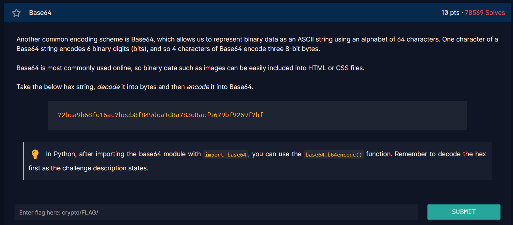

# Base64



## Description

The challenge provides a hexadecimal string and asks us to first decode it into bytes, then encode those bytes using Base64.

## Analysis

The input is given as a hexadecimal string, so the first step is to convert it into raw bytes using `bytes.fromhex()`.

Once we have the bytes, we can use Python's `base64.b64encode()` function to encode them into a Base64 string.

## Solution

```python
import base64

hex_string = "72bca9b68fc16ac7beeb8f849dca1d8a783e8acf9679bf9269f7bf"

data = bytes.fromhex(hex_string)
result = base64.b64encode(data).decode()

print(result)
```

Output:

```text
crypto/Base+64+Encoding+is+Web+Safe/
```

## Flag

```text
crypto/Base+64+Encoding+is+Web+Safe/
```

## Takeaways

- Base64 is an encoding scheme, not an encryption algorithm.
- `bytes.fromhex()` converts hexadecimal strings into raw bytes.
- `base64.b64encode()` converts bytes into a Base64-encoded byte string.
- Always check the expected flag format instead of assuming it is `crypto{...}`.