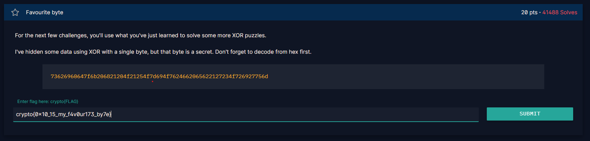

# Favourite Byte



## Description

The challenge provides a hexadecimal string that has been XOR-encrypted using a single unknown byte.

Our objective is to recover both the key and the original plaintext.

## Analysis

Since the ciphertext is encrypted with a single-byte XOR key, there are only **256 possible keys**.

A brute-force approach is sufficient:

1. Convert the hexadecimal string into bytes.
2. XOR every byte with each possible key (`0x00` to `0xff`).
3. Check the output for readable text or the expected `crypto{...}` flag format.

## Solution

```python
cipher = bytes.fromhex(
    "73626960647f6b206821204f21254f7d694f7624662065622127234f726927756d"
)

for key in range(256):
    plaintext = bytes(c ^ key for c in cipher)

    if plaintext.startswith(b"crypto{"):
        print(f"Key: {key:#02x}")
        print(plaintext.decode())
        break
```

Output:

```text
Key: 0x10
crypto{0x10_15_my_f4v0ur173_by7e}
```

## Flag

```text
crypto{0x10_15_my_f4v0ur173_by7e}
```

## Takeaways

- A single-byte XOR cipher has a very small key space (256 possible keys).
- Brute-forcing every possible key is both practical and efficient.
- Recognizable plaintext patterns, such as `crypto{...}`, make it easy to identify the correct key.