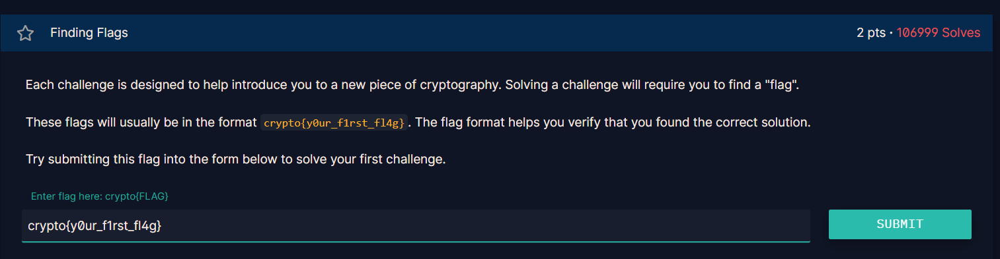

# Finding Flags



## Description

This introductory challenge explains the flag format used throughout CryptoHack.

Flags are typically wrapped in the following format:

```text
crypto{...}
```

The challenge provides an example flag and asks the user to submit it.

## Analysis

There is no cryptography involved in this challenge.

The challenge description explicitly reveals the flag:

```text
crypto{y0ur_f1rst_fl4g}
```

The objective is simply to understand the expected flag format before proceeding to more advanced challenges.

## Solution

Copy the provided flag and submit it.

```text
crypto{y0ur_f1rst_fl4g}
```

## Flag

```text
crypto{y0ur_f1rst_fl4g}
```

## Takeaways

- CryptoHack flags follow the format `crypto{...}`.
- Always read the challenge description carefully.
- Some introductory challenges are designed to familiarize users with the platform rather than test cryptographic knowledge.