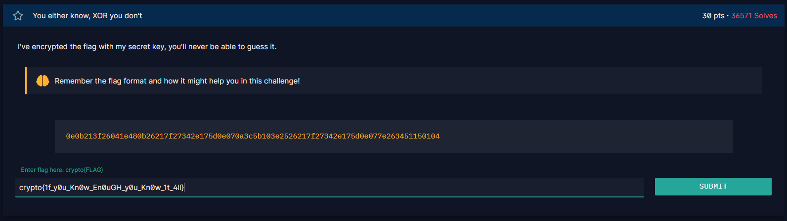

# You either know, XOR you don't



## Description

The challenge provides a ciphertext encrypted with a repeating XOR key. It also hints that the flag format can help us recover the key.

## Analysis

We know that every CryptoHack flag starts with:

```text
crypto{
```

Since XOR is reversible:

```text
plaintext ^ key = ciphertext
ciphertext ^ plaintext = key
```

We can XOR the first seven bytes of the ciphertext with the known prefix `crypto{` to recover the repeating key.

The recovered key is:

```text
myXORkey
```

Once the key is known, we simply repeat it across the ciphertext to decrypt the entire message.

## Solution

```python
cipher = bytes.fromhex(
    "0e0b213f26041e480b26217f27342e175d0e070a3c5b103e2526217f27342e175d0e077e263451150104"
)

key = b"myXORkey"

flag = bytes(
    c ^ key[i % len(key)]
    for i, c in enumerate(cipher)
)

print(flag.decode())
```

Output:

```text
crypto{1f_y0u_Kn0w_En0uGH_y0u_Kn0w_1t_4ll}
```

## Flag

```text
crypto{1f_y0u_Kn0w_En0uGH_y0u_Kn0w_1t_4ll}
```

## Takeaways

- Known-plaintext attacks are effective when part of the plaintext is predictable.
- XOR is reversible: knowing either the plaintext or the key allows recovery of the other.
- Repeating-key XOR is insecure because repeated plaintext patterns can reveal the key.