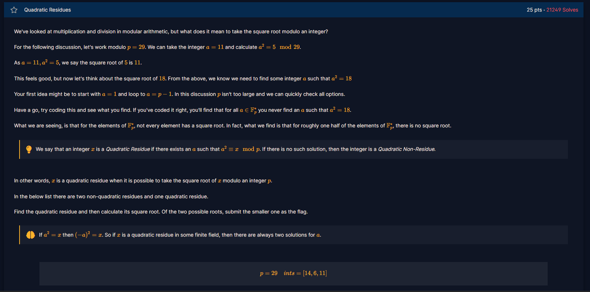

# Quadratic Residues



## Description

The challenge introduces quadratic residues in modular arithmetic.

An integer `x` is a quadratic residue modulo `p` if there exists an integer `a` such that:

```text
a² ≡ x (mod p)
```

We are given three values, two of which are quadratic non-residues and one of which is a quadratic residue. The goal is to find the quadratic residue and calculate its square root modulo `p = 29`.

## Analysis

To determine whether a value is a quadratic residue, we can simply try every possible value of `a` from `1` to `p - 1` and check:

```text
a² mod p == x
```

For the given values, only `6` has a valid square root:

```text
8² mod 29 = 64 mod 29 = 6
```

The two roots are:

```text
8
21
```

This is because:

```text
(-8)² ≡ 8² (mod 29)
```

and `-8 mod 29 = 21`.

The challenge asks us to submit the smaller root, so the answer is `8`.

## Solution

```python
p = 29

values = [
    14, 6, 19
]

for x in values:
    roots = [
        a for a in range(1, p)
        if a * a % p == x
    ]

    if roots:
        print(f"Quadratic residue: {x}")
        print(f"Roots: {roots}")
        print(f"Number: {min(roots)}")
```

Output:

```text
Quadratic residue: 6
Roots: [8, 21]
Number: 8
```

## Flag

```text
8
```

## Takeaways

- A quadratic residue has a square root modulo `p`.
- A non-zero quadratic residue modulo a prime has two roots.
- The two roots are `a` and `p - a`.
- For small moduli, brute force is a simple way to find modular square roots.