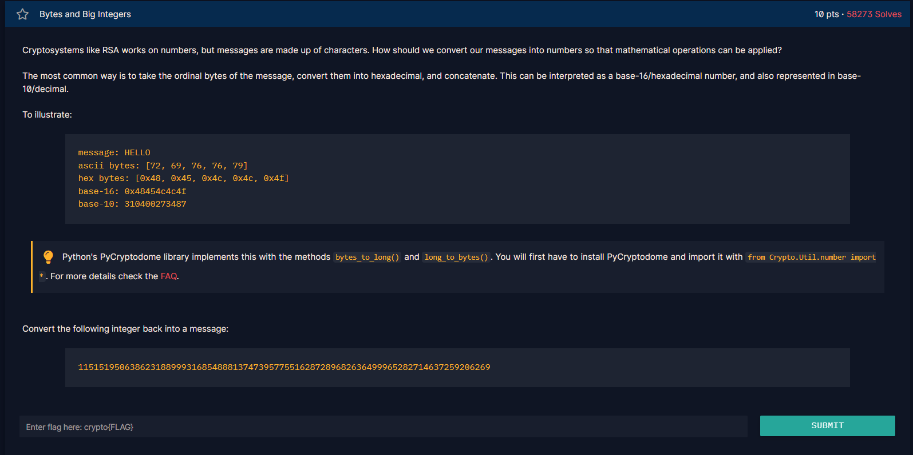

# Bytes and Big Integers



## Description

The challenge explains how messages can be represented as integers by interpreting their hexadecimal representation as a single large number.

Our task is to convert the given integer back into its original message.

## Analysis

Cryptographic algorithms such as RSA operate on integers rather than strings. A common approach is to encode a message as bytes and interpret those bytes as one large integer.

PyCryptodome provides two helper functions for this conversion:

- `bytes_to_long()` converts bytes into an integer.
- `long_to_bytes()` converts an integer back into bytes.

Since the challenge gives us the integer representation, we simply use `long_to_bytes()` and decode the resulting bytes.

## Solution

```python
from Crypto.Util.number import long_to_bytes

cipher = 11515195063862318899931685488813747395775516287289682636499965282714637259206269

flag = long_to_bytes(cipher).decode()

print(flag)
```

Output:

```text
crypto{3nc0d1n6_4ll_7h3_w4y_d0wn}
```

## Flag

```text
crypto{3nc0d1n6_4ll_7h3_w4y_d0wn}
```

## Takeaways

- RSA and many public-key cryptosystems operate on integers instead of strings.
- `bytes_to_long()` and `long_to_bytes()` simplify conversions between byte strings and integers.
- Understanding how messages are encoded is essential before studying public-key cryptography.