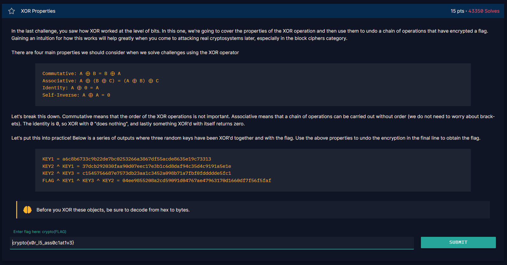

# XOR Properties



## Description

The challenge introduces the fundamental properties of the XOR operation and provides several XOR combinations of three secret keys and the encrypted flag.

Our goal is to recover the original flag by reversing the XOR operations.

## Analysis

The following values are given:

```text
KEY1
KEY2 ^ KEY1
KEY2 ^ KEY3
FLAG ^ KEY1 ^ KEY3 ^ KEY2
```

Using the properties of XOR:

- Commutative: `A ^ B = B ^ A`
- Associative: `A ^ (B ^ C) = (A ^ B) ^ C`
- Identity: `A ^ 0 = A`
- Self-Inverse: `A ^ A = 0`

We can derive the missing keys:

```text
KEY2 = (KEY2 ^ KEY1) ^ KEY1
KEY3 = (KEY2 ^ KEY3) ^ KEY2
```

Finally, recover the flag:

```text
FLAG = (FLAG ^ KEY1 ^ KEY2 ^ KEY3) ^ KEY1 ^ KEY2 ^ KEY3
```

Since every key XORed with itself equals zero, all keys cancel out, leaving only the original flag.

## Solution

```python
from pwn import xor

KEY1 = bytes.fromhex("a6c8b6733c9b22de7bc0253266a3867df55acde8635e19c73313")
KEY2_XOR_KEY1 = bytes.fromhex("37dcb292030faa90d07eec17e3b1c6d8daf94c35d4c9191a5e1e")
KEY2_XOR_KEY3 = bytes.fromhex("c1545756687e7573db23aa1c3452a098b71a7fbf0fddddde5fc1")
FLAG_XOR_ALL = bytes.fromhex("04ee9855208a2cd59091d04767ae47963170d1660df7f56f5faf")

KEY2 = xor(KEY2_XOR_KEY1, KEY1)
KEY3 = xor(KEY2_XOR_KEY3, KEY2)
flag = xor(FLAG_XOR_ALL, KEY1, KEY2, KEY3)

print(flag.decode())
```

Output:

```text
crypto{x0r_i5_ass0c1at1v3}
```

## Flag

```text
crypto{x0r_i5_ass0c1at1v3}
```

## Takeaways

- XOR is its own inverse, making it easy to undo encryption when enough information is known.
- Thanks to the associative and commutative properties, XOR operations can be rearranged without affecting the result.
- Many stream ciphers and cryptographic attacks rely heavily on these XOR properties.