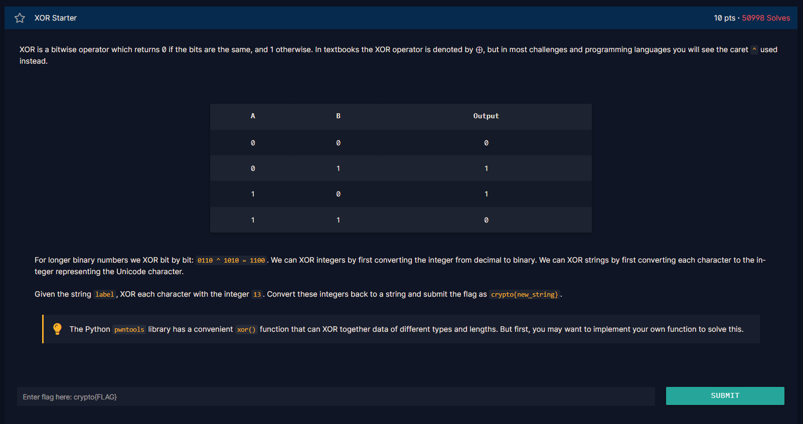

# XOR



## Description

The challenge introduces the XOR bitwise operation and explains how it can be applied to binary data.

Our task is to XOR each character of the string `label` with the integer `13`, then convert the resulting values back into characters to obtain the flag.


## Analysis

XOR is a bitwise operator that returns `1` when two bits are different and `0` when they are the same.

In this challenge, each character in the string must be converted into its ASCII value before applying XOR.

For example:

```
l = 108

108 ^ 13 = 97
97 -> 'a'
```

Applying the same operation to all characters:

```
label
```

gives:

```
aloha
```

The result is then wrapped inside the `crypto{}` format to obtain the flag.


## Solution

```python
def xor_string(text, key):
    result = ""

    for char in text:
        result += chr(ord(char) ^ key)

    return result


text = "label"
key = 13

flag = xor_string(text, key)

print(f"crypto{{{flag}}}")
```

Output:

```text
crypto{aloha}
```


## Flag

```text
crypto{aloha}
```


## Takeaways

- XOR is a fundamental bitwise operation widely used in cryptography.
- Characters can be XORed by converting them into their ASCII integer representation.
- The XOR operation is reversible because applying the same key twice returns the original value.